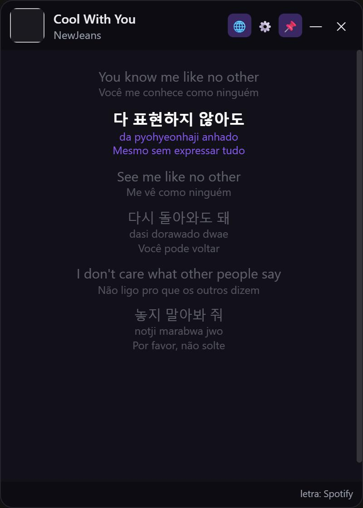
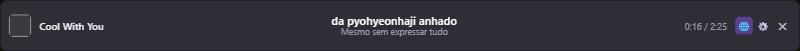

# Letra no Ar 🎵

Uma janelinha **sempre em primeiro plano** (Windows) que mostra a **letra sincronizada** da música
tocando no **Spotify** — e rola no tempo certo, como o recurso de letras do próprio Spotify.

Serve pra **acompanhar a letra de qualquer tela** — em cima de um jogo, vídeo, stream, o que for — sem
precisar abrir o Spotify na frente. Fica de canto ou encostada na barra de tarefas.

E o **modo barra**, pra encostar na barra de tarefas:

## O que faz

- Pega a música tocando no Spotify e mostra a **letra sincronizada**, com a linha da vez destacada e rolagem automática.
- **Letra direto do Spotify** (a mesma do app, sincronia idêntica); senão cai no **LRCLIB / NetEase** como reserva.
- **Romanização** do coreano e do **japonês** (inclusive kanji) e **tradução em português**.
- **Modo barra**: deixe a janela bem baixinha e ela vira uma faixa horizontal
  `capa | música | ····· letra ····· | tempo`, mostrando só a linha da vez.
- Sempre em primeiro plano, sem bordas, arrastável, com opacidade e "modo fantasma" (clicar através, Ctrl+Alt+L).

## Como baixar e usar

1. Baixe o **instalador** ou a versão **portátil** na página de [Releases](../../releases).
2. Abra o app e clique na **engrenagem (⚙️)**.
3. **Conectar o Spotify** (saber o que está tocando): crie um app grátis no Spotify e cole o **Client ID** —
   o passo a passo está no próprio app (tutorial "Como criar seu app do Spotify"). Depois clique em **Conectar o Spotify**.
4. **Conectar letras do Spotify**: faça login na janelinha que abre. Isso traz a letra igual à do Spotify (não precisa de app).
5. *(Opcional)* cole uma **chave DeepL** no campo das opções pra tradução melhor (tem tutorial também). Sem ela, uso o MyMemory.
6. Dê **play** numa música no Spotify — a letra começa a rolar. ✨

> Cada pessoa usa o próprio app do Spotify e o próprio login, então funciona pra qualquer um, em qualquer PC.

## Avisos

- A letra vem de um endpoint **não-oficial** do Spotify e pode mudar com o tempo; quando mudar, precisa atualizar.
- Nenhum segredo (cookie/token/chave) fica no repositório — tudo mora só na sua máquina (`%APPDATA%\letra-no-ar`).

---

Feito pra acompanhar a letra da música em qualquer tela. 🎶
